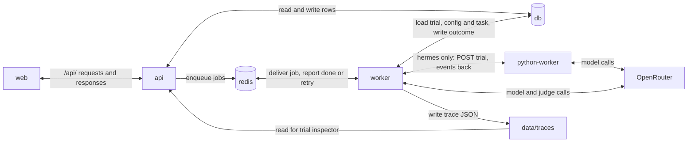

# agent-evals

Platform for comparing agent configs (harness × model × settings) on a shared task set: N trials per cell, sandboxed runs, deterministic and LLM graders, bootstrap/McNemar compare, full traces, JSON/CSV export.

Harnesses: `baseline` (TypeScript tool loop), `hermes` (Python worker) and `claude-agent` (Claude Agent SDK, through OpenRouter). Models go through OpenRouter (or your own adapter).

---

## Setup

**Prerequisites:** Docker with Compose, an OpenRouter API key with credit. For host-side tests/scripts: Node.js 24, `uv`, Python 3.12+.

```bash
cp .env.example .env
# set OPENROUTER_API_KEY=...

docker compose up --build
```

- Web UI: http://localhost:5173  
- API: http://localhost:3000  
- `seed` loads the 22-task catalog once and exits.

Useful `.env` knobs: `TRIAL_CONCURRENCY=1` on a small balance; `*_HOST_PORT` if a port is taken; `PRICE_TABLE_PATH` for a custom price table. `.env` is never committed.

### Fresh run / reset

Wipe DB and sandboxes (Compose volumes), then start clean. Tasks are reseeded; host `results/` and `data/traces/` are left alone (traces are bind-mounted from `./data/traces`, gitignored).

```bash
docker compose down -v
docker compose up --build -d
```

Optional: clear host-side artifacts only (does not clear Postgres):

```bash
rm -rf data/traces/*    # trial traces (Docker and host both write here)
rm -rf results/*        # CLI exports; skip if you still need demo/experiment artifacts
```

Do not delete `tasks/`, `fixtures/`, `prices.json`, or `.env`.

---

## Add a task

1. Write [`tasks/<group>/<name>.json`](tasks/) using `TaskSchema` in [`packages/domain/src/schemas.ts`](packages/domain/src/schemas.ts) (`id`, `version`, `name`, `description`, `prompt`, `graders`, `tags`; optional `setup`, `toolsAllowed`, `expectedDiscriminators`). Copy a peer task and edit.
2. Add the path to [`tasks/manifest.json`](tasks/manifest.json).
3. Validate: `npx tsx` [`scripts/validate-task-set.ts`](scripts/validate-task-set.ts) (min 20 tasks, grader coverage, rubrics, priced judge models).
4. Load: `npm run seed:tasks` (or `docker compose up --build seed`). Use `--build` after changing anything under [`tasks/`](tasks/), because the seed container reads the task files baked into the image at build time.

---

## Add a harness

A harness is the agent loop under test. The runner calls `harness.run(input)` and grades what it returns.

1. **Implement it** in [`packages/adapters-harness/src/<id>.ts`](packages/adapters-harness/src/): a class with `id`, `displayName` and `run(input)`, implementing `HarnessAdapter` from [`types.ts`](packages/adapters-harness/src/types.ts). In `run`:
   - Send every trace event through `input.context.emit`. Event shapes are `TraceEventSchema` in [`schemas.ts`](packages/domain/src/schemas.ts).
   - Stop at the limits in `input.context.budgets`: `maxSteps` (model calls), `maxTokens` (total tokens), `timeoutMs` (wall clock). Return the matching `stoppedReason`.
   - Return `{ finalAnswer, stoppedReason, usage, stepCount }` (`HarnessRunOutput`).

   Start from a working harness: [`baseline.ts`](packages/adapters-harness/src/baseline.ts) runs the loop in-process using `input.model`; [`hermes.ts`](packages/adapters-harness/src/hermes.ts) delegates to a separate runtime over HTTP and re-emits its events; [`claude-agent.ts`](packages/adapters-harness/src/claude-agent.ts) wraps the Claude Agent SDK, which owns the loop, and maps its messages to trace events.
2. **Register it** in [`registry.ts`](packages/adapters-harness/src/registry.ts): add the id to `HARNESS_IDS` and a `case` in `createHarness`.
3. **Show it in the UI** by adding the id to `HARNESS_IDS` in [`apps/web/src/lib/forms.ts`](apps/web/src/lib/forms.ts). This is a separate list that feeds the Configs dropdown.
4. **Test it**: add [`<id>.spec.ts`](packages/adapters-harness/src/) (model it on [`baseline.spec.ts`](packages/adapters-harness/src/baseline.spec.ts)) and update the id list asserted in [`registry.spec.ts`](packages/adapters-harness/src/registry.spec.ts). Then run the registry test:
   ```bash
   npx vitest run packages/adapters-harness/src/registry.spec.ts
   ```
5. **Use it**: rebuild the stack with `docker compose up --build -d api worker web`. Then create a config whose `harness.id` is the new id, so experiments can run it. You can do this in the Configs page of the web app, or with `POST /configs` on the API.

Interface details: [DESIGN.md](deliverables/DESIGN.md) §2.

---

## Add a model

A model is the LLM a config calls. Models are reached through OpenRouter, so adding one needs only a price and a UI entry.

1. **Price it** in [`prices.json`](prices.json): `"<provider>/<model>": { "inputPerMTok": …, "outputPerMTok": … }`. Unpriced models fail trials before any call (`price_missing`).
2. **Show it in the UI** by adding the id to `MODEL_IDS` in [`apps/web/src/lib/forms.ts`](apps/web/src/lib/forms.ts). This feeds the Configs model dropdown.
3. **Use it**: rebuild the stack with `docker compose up --build -d api worker web`. Then create a config with that model in the Configs page of the web app, or with `POST /configs` on the API.

Interface details: [DESIGN.md](deliverables/DESIGN.md) §2.

---

## Sample experiment

The experiment compares two configs on the same tasks: memory on vs memory off, both on the Hermes harness. The CLI, [`scripts/run-experiment.ts`](scripts/run-experiment.ts), creates the configs and the experiment through the API, starts it, and waits for it to finish.

1. **Start the stack**: `docker compose up --build -d`. The `worker` runs the trials and needs the Python worker that Hermes uses. Check that everything is up with `docker compose ps`.
2. **Load the tasks**: `docker compose up --build seed`. Skip this if the catalog is already loaded, and rerun it after changing anything under [`tasks/`](tasks/).
3. **Check the plan**: `npx tsx scripts/run-experiment.ts --dry-run`. It prints the task count and trial total, and sends nothing to the API.
4. **Run it**:
   ```bash
   npx tsx scripts/run-experiment.ts --name full-catalog --n 3 --configs mem-off,mem-on --tasks all
   ```
   Defaults are the full catalog, N = 3, and memory on vs off. Each `--tasks` value is a group: `all`, `memory`, `control`, `judge`, or `skill`.
5. **Resume if it stops**: `npx tsx scripts/run-experiment.ts --resume <experimentId>`. This starts no new trials; it only waits for the existing ones and exports the results.
6. **Read the results**: the run writes `results/<experimentId>/` with `compare.json`, `export.json` and `export.csv`. The worker writes the same folder for experiments started from the UI. The write-up and analysis are in [EXPERIMENT.md](deliverables/EXPERIMENT.md).

   In `compare.json`, `delta` is config A's pass rate minus config B's, so its sign depends on which config is A. A is the first config in the experiment. The CLI lists `mem-on` first, so its delta is memory on minus memory off. The UI compare page takes A from the same first-config order, so the sign can flip if the configs were created in the other order.

---

## Skills

A skill is a named bundle of tools that a config turns on. Today there is one, `csv_summary`, which adds the `csv_summary` tool. Skill ids are listed in `SKILL_IDS` in [`apps/web/src/lib/forms.ts`](apps/web/src/lib/forms.ts), and each id maps to its tools in [`packages/adapters-harness/src/skills.ts`](packages/adapters-harness/src/skills.ts).

- The API expands each enabled skill into tool names before any harness runs (`resolveToolIds` in [`tools.ts`](packages/adapters-harness/src/tools.ts)). This applies to every harness.
- Hermes receives those tool names in `toolIds`, never the skill ids. Its worker keeps its own copy of the skill-to-tool map in [`tools.py`](workers/python-worker/src/agent_evals_python_worker/tools.py).

To add a skill, add its tool to `skills.ts`, add its id to `SKILL_IDS` in `forms.ts`, then mirror the tool in `tools.py` so Hermes can call it. Rebuild with `docker compose up --build -d api worker python-worker web`.

---

## More docs

| Doc | Contents |
|---|---|
| [DESIGN.md](deliverables/DESIGN.md) | Architecture, adapters, data model, isolation, graders, stats |
| [EXPERIMENT.md](deliverables/EXPERIMENT.md) | Memory on vs off experiment and results |
| [LIMITS.md](deliverables/LIMITS.md) | Known limits |
| [COST.md](deliverables/COST.md) | Cost formula and spend |
| [BUILD_LOG.md](BUILD_LOG.md) | Ordered application build steps |

## Code map

Where each part of the system lives. The module header in each `src` file describes its local contract; start with [DESIGN.md](deliverables/DESIGN.md) for the system picture.

| Path | Role |
|---|---|
| [`apps/api`](apps/api/) | Nest HTTP API + queue worker (`main.ts` / `worker.ts`); Postgres + BullMQ |
| [`apps/web`](apps/web/) | Vue 3 UI (tasks, configs, experiments, compare, trial inspector) |
| [`packages/domain`](packages/domain/) | Shared Zod schemas and pricing helpers |
| [`packages/runner`](packages/runner/) | `runTrial`: sandbox → harness → graders → cleanup |
| [`packages/adapters-harness`](packages/adapters-harness/) | Harnesses `baseline`, `hermes` (HTTP client) and `claude-agent` (Claude Agent SDK); tools / memory / skills |
| [`packages/adapters-model`](packages/adapters-model/) | OpenRouter (+ mock/scripted for tests) |
| [`packages/graders`](packages/graders/) | exact_match, state_check, unit_test, llm_judge |
| [`packages/stats`](packages/stats/) | Bootstrap, McNemar, compare, failure categories |
| [`packages/sandbox`](packages/sandbox/) · [`packages/trace`](packages/trace/) | Per-trial dirs; in-memory trace buffer |
| [`workers/python-worker`](workers/python-worker/) | Hermes FastAPI worker (`POST /run-trial`) |
| [`tasks/`](tasks/) · [`fixtures/`](fixtures/) · [`scripts/`](scripts/) | Catalog, judge/stats fixtures, CLIs |
| [`data/traces/`](data/traces/) | Trial JSON traces (gitignored; Compose bind-mount) |

---

## Validate the LLM judge (human labels)

Where a task uses `llm_judge`, check the judge against a small set of human-labelled examples before trusting experiment scores. Run this after changing a rubric, threshold, or judge model.

1. **Know the labels**: [`fixtures/judge-human-labels/`](fixtures/judge-human-labels/) holds 25 answers (5 per judged task), each with `humanPassed` and notes. Rubrics and the judge model come from the matching task under [`tasks/judge/`](tasks/judge/).
2. **Run it**: needs `OPENROUTER_API_KEY` in `.env`, and calls the same `llmJudge()` path as trials.
   ```bash
   npx tsx scripts/validate-judge.ts | tee judge-validation.txt
   ```
   The CLI is [`scripts/validate-judge.ts`](scripts/validate-judge.ts).
3. **Read the output**: agreement rate, Cohen’s κ, confusion matrix, per-task κ, and every disagreement with the judge’s reasoning.
4. **Check the gate**: the script exits `0` only if κ ≥ 0.6 and every label was judged without setup errors; otherwise it exits `1`.
5. **Save the result**: commit the new [`judge-validation.txt`](judge-validation.txt) if you want the artifact in the repo. The last saved run had 92% agreement (23/25) and κ = 0.826. The limits of this check (one labeller, n = 25) are in [LIMITS.md](deliverables/LIMITS.md) §2 and [DESIGN.md](deliverables/DESIGN.md) §5.

---

## How the containers work together

`docker compose up` starts seven services from [`docker-compose.yml`](docker-compose.yml). Inside the stack they reach each other by service name.

| Container | Image | Role | Talks to |
|---|---|---|---|
| `db` | `postgres:16` | Stores tasks, configs, experiments, trials and scores | `api`, `worker` |
| `redis` | `redis:7` | Holds the BullMQ `trials` queue, one job per trial | `api`, `worker` |
| `api` | `agent-evals-node` | HTTP API on `:3000`. Creates experiments, enqueues trials, serves compare / export / traces. Runs no trials (`TRIAL_WORKER=off`) | `db`, `redis`, `data/traces/` |
| `worker` | `agent-evals-node` | Same image as `api`, started as [`worker.js`](apps/api/src/worker.ts). Takes jobs off the queue and runs each trial | `db`, `redis`, `python-worker`, OpenRouter |
| `python-worker` | `agent-evals-python-worker` | Runs trials for the `hermes` harness (`POST /run-trial` on `:8001`) | `worker`, OpenRouter |
| `web` | nginx + Vue build | UI on `:5173`; nginx proxies `/api/` to `api:3000` | `api` |
| `seed` | `agent-evals-node` | One-shot: loads the task catalog through the API, then exits | `api` |

**Start-up order** (`depends_on`): `db` and `redis` become healthy first, then `api`. `seed` and `web` wait for `api`. `worker` waits for both `api` and `python-worker`. Each healthy service shows `Healthy`; `seed` shows `Started` and exits once it has loaded the tasks.

**Shared storage**

- `sandboxes` volume, mounted at `/sandboxes` in `worker` and `python-worker`. Trial sandboxes are created under it (`TMPDIR=/sandboxes`), and the Hermes harness reads and writes them by the same absolute path.
- `./data/traces`, bind-mounted into `api` and `worker`. The worker writes each trial’s JSON trace; the API reads it back for the trial inspector.
- `./results`, bind-mounted into `worker`. When an experiment finishes, the worker writes `results/<experimentId>/` with `export.json`, `export.csv`, and `compare.json` (only when the experiment has two configs). Set by `RESULTS_DIR`; unset means no files are written.
- `pgdata` and `hermes` volumes keep Postgres data and the Hermes home between restarts.

### How a task gets fulfilled



1. **Load tasks**: `seed` posts the catalog from [`tasks/`](tasks/) to the `api`, which stores it in `db`.
2. **Define the experiment**: in the `web` UI (or via the API) you create configs (harness × model × settings), then an experiment of tasks × configs × N trials. Requests go through nginx `/api/` to the `api`.
3. **Start it**: `POST /experiments/:id/start` expands the matrix into one trial row per cell in `db`, then enqueues one job per trial in `redis`.
4. **Pick up a job**: the `worker` takes a job (up to `TRIAL_CONCURRENCY` at once), marks the trial `running`, and loads its trial, config and task from `db` ([`trial-executor.service.ts`](apps/api/src/execution/trial-executor.service.ts)).
5. **Run the trial**: `runTrial` in [`packages/runner`](packages/runner/) creates a sandbox under `/sandboxes`, then calls the harness chosen by the config:
   - `baseline` and `claude-agent` run inside the `worker` and call the model through OpenRouter.
   - `hermes` makes the `worker` POST the trial to `python-worker`, which runs the Hermes agent in the same sandbox path, calls OpenRouter, and returns the events and final answer.
6. **Grade it**: still in the `worker`, the graders score the sandbox and answer. `llm_judge` graders call OpenRouter again.
7. **Record it**: the `worker` writes the trace to `data/traces/`, then the outcome, score and cost to `db`, and updates the experiment status once all its trials are done. When that last trial is recorded, the `worker` also writes the result files to `results/<experimentId>/`. A retryable failure puts the trial back in `redis` for another attempt with backoff.
8. **Read the results**: the `web` UI (or `GET /experiments/:id/compare` and `/export`) reads trial rows from `db` and traces from `data/traces/`. Comparison statistics are computed by the `api`.

### Inspect the database

Open a `psql` shell inside the `db` container (the stack must be running):

```bash
docker compose exec db psql -U evals -d evals
```

Useful commands. `\` commands are psql meta-commands; type them at the `evals=#` prompt.

```sql
\dt                                   -- list tables: configs, experiments, tasks, trials
\d trials                             -- show a table's columns and types
\q                                    -- quit
```

Columns are camelCase, so quote them in SQL (for example `"taskId"`). Unquoted, Postgres folds them to lowercase and the query fails.

```sql
-- 1. find experiment IDs
-- just the latest experiment ID
SELECT id FROM experiments ORDER BY "createdAt" DESC LIMIT 1;

-- all experiments, newest first: copy an id into the '<experiment-id>' placeholder in step 2
SELECT id, name, status, "nTrials", "createdAt"
FROM experiments
ORDER BY "createdAt" DESC;

-- 2. one experiment, grouped by status: trial count, passes, average score, total cost (replace the id)
SELECT status,
       count(*)                                                 AS trials,
       sum(CASE WHEN passed THEN 1 ELSE 0 END)                  AS passed,
       round(avg(score)::numeric, 3)                            AS avg_score,
       round(sum((metrics->>'estimatedCostUsd')::numeric), 4)   AS total_cost_usd
FROM trials
WHERE "experimentId" = '<experiment-id>'
GROUP BY status;

-- 3. latest trials: outcome, score, cost and error
SELECT id, status, passed, score,
       metrics->>'estimatedCostUsd' AS cost_usd,
       metrics->>'totalTokens'      AS tokens,
       error->>'code'               AS error_code
FROM trials
ORDER BY "finishedAt" DESC NULLS LAST
LIMIT 10;

-- 4. total estimated cost across all trials
SELECT round(sum((metrics->>'estimatedCostUsd')::numeric), 4) AS total_cost_usd
FROM trials;

-- 5. configs in the database
SELECT id, name, version, "contentHash" FROM configs;
```

`trials.status` is one of `queued`, `running`, `succeeded`, `failed`, `timeout` or `cancelled`. `trials."traceUri"` is the trace file's key under `data/traces/`.

Cost is not a column. It lives in the `metrics` JSON as `estimatedCostUsd`, computed from `prices.json`, so it is an estimate rather than a billed amount. It includes judge tokens. Trials that fail during setup record `0`, and `metrics` stays `{}` until a trial finishes, so queued and running trials have no cost yet.

### Inspect the queue

The trial queue lives in Redis under the BullMQ queue name `trials`. Run these from your Mac while the stack is up. Each command prints one number, which is the count of jobs in that state.

| Status | Command | Meaning |
|---|---|---|
| waiting | `docker compose exec redis redis-cli llen bull:trials:wait` | Queued, not yet picked up by a worker |
| active | `docker compose exec redis redis-cli llen bull:trials:active` | A worker is running the trial now |
| delayed | `docker compose exec redis redis-cli zcard bull:trials:delayed` | Waiting out a retry backoff |
| failed | `docker compose exec redis redis-cli zcard bull:trials:failed` | Failed after all attempts |
| completed | `docker compose exec redis redis-cli zcard bull:trials:completed` | Finished; BullMQ keeps the most recent 1000 (the count stops at 1000) |

For all five at once:

```bash
for s in wait active; do echo -n "$s: "; docker compose exec -T redis redis-cli llen bull:trials:$s; done
for s in delayed failed completed; do echo -n "$s: "; docker compose exec -T redis redis-cli zcard bull:trials:$s; done
```

`wait` and `active` are lists, so they use `llen`. The other three are sorted sets, so they use `zcard`.

To see the failed job IDs, or one job's details (the job ID is the trial ID):

```bash
docker compose exec redis redis-cli zrange bull:trials:failed 0 -1
docker compose exec redis redis-cli hgetall bull:trials:<trial-id>
```

A job hash holds its `data` (including the trial ID), `atm` (attempts made) and, if it failed, `failedReason`.

Which containers to rebuild after a change is covered in [Add a task](#add-a-task), [Add a harness](#add-a-harness) and [Add a model](#add-a-model).
