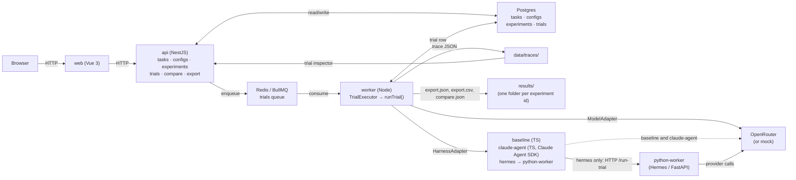

# Design

Agent Evals compares two agent configurations on the same tasks. A config is immutable (harness, model, memory, tools, budgets) identified by a content hash. An experiment runs N trials per config per task, grades each trial, and compares configs with a paired bootstrap interval, per-task deltas, and an exact McNemar test.

## 1. Architecture



| Component | Responsibility |
|---|---|
| `apps/api` | HTTP API, persistence (TypeORM), queue producer. `TRIAL_WORKER=off` in the API container. |
| `apps/api` worker | Consumes the trials queue. `TrialExecutor` creates the sandbox, runs the trial, writes the trace and the trial row in one transaction, and rolls the experiment status up. When the last trial of an experiment is recorded, `ExperimentResultsWriter` writes `results/<experimentId>/` (only if `RESULTS_DIR` is set). |
| `apps/web` | Pages for tasks, configs (harness + priced-model dropdowns), experiments (task select-all, trials table with trial ids), compare, failures summary, and the trial inspector. Calls the API only. |
| `packages/domain` | Zod schemas and types (Task, Config, Experiment, Trial, TraceEvent, PriceTable) and `costUsd`. No I/O. |
| `packages/runner` | `runTrial`: one trial from sandbox to graded result. Enforces the timeout and the infra-versus-scored split. Imports no harness or provider. |
| `packages/adapters-harness` | `HarnessAdapter` interface, baseline TypeScript loop, Hermes client, Claude Agent SDK harness, tools, memory, skills, registry. |
| `packages/adapters-model` | `ModelAdapter` interface, OpenRouter and mock adapters, registry. |
| `packages/graders` | `exact_match`, `state_check`, `unit_test`, `llm_judge`, rubric registry. |
| `packages/sandbox` | Per-trial directories and path-safe file operations. |
| `packages/trace` | In-memory per-trial event buffer and trace (de)serialization. The worker writes the JSON file. |
| `packages/stats` | Macro pass rate, paired bootstrap, exact McNemar, per-task deltas, verdict, failure categories. |
| `workers/python-worker` | FastAPI service that runs Hermes Agent for one trial at a time. |
| `data/traces/` | Bind-mounted trial JSON (`TRACE_DIR`); gitignored. |
| `results/` | Bind-mounted at `/results` in the worker (`RESULTS_DIR`). One folder per experiment id with `export.json`, `export.csv` and, for two configs, `compare.json`. |

Dependency direction: `domain` ← everything. `runner` receives a `HarnessAdapter` and builds the model via `createModelAdapter`; it names no concrete harness. Adding a harness or model is a registry change (§2), not a core change.

## 2. Harness and model adapter interfaces

### Harness

```ts
interface HarnessAdapter {
  readonly id: string;
  readonly displayName: string;
  run(input: HarnessRunInput): Promise<HarnessRunOutput>;
}

interface HarnessRunInput {
  task: Task;
  model: ModelAdapter;          // baseline calls the model through this
  modelId: string;
  modelParams: { temperature: number; topP?: number };
  context: TrialContext;        // trialId, seed, sandboxDir, budgets, memory, skillIds, toolIds, emit()
}

interface HarnessRunOutput {
  finalAnswer: string;
  stoppedReason: 'completed' | 'max_steps' | 'max_tokens' | 'timeout' | 'error';
  usage: { promptTokens: number; completionTokens: number };
  stepCount: number;
}
```

The harness must emit every step through `context.emit`, stop when budgets (`maxSteps`, `maxTokens`, `timeoutMs`) run out, and use only the sandbox and tools in `toolIds`.

**Shipped harnesses:**

- `baseline` — TypeScript tool-calling loop; calls the model through `ModelAdapter`.
- `hermes` — Hermes Agent in the Python worker. `HermesHarness` posts one trial (`POST /run-trial`) and maps the reply into trace events. Hermes makes its own model calls; the worker reports usage.
- `claude-agent` — wraps the Claude Agent SDK, which owns the loop. It runs in the worker, calls models through OpenRouter, and maps SDK messages to trace events. It is only dependable with Anthropic models; see [LIMITS.md](LIMITS.md).

**To add a harness:** implement `HarnessAdapter` in `packages/adapters-harness/src/<id>.ts`, register in `registry.ts` (`HARNESS_IDS` + `createHarness`), add the id to `HARNESS_IDS` in `apps/web/src/lib/forms.ts` so the Configs dropdown offers it, and add a spec. A config selects it with `harness.id`. Separate runtimes (like Hermes) stay behind an HTTP contract; the adapter is a thin client.

### Model

```ts
interface ModelAdapter {
  readonly id: string;
  complete(modelId: string, req: ModelRequest): Promise<ModelResponse>;
}

interface ModelRequest {
  messages: ChatMessage[];
  tools?: ToolSpec[];
  temperature: number;
  maxTokens: number;
  stop?: string[];
  responseFormat?: 'json';
}

interface ModelResponse {
  message: ChatMessage;
  usage: { promptTokens: number; completionTokens: number };
  raw?: unknown;
}
```

A config names `{ provider, modelId, temperature, topP? }`. The provider picks the adapter (`parseModelSpec("openrouter:openai/gpt-4.1-mini")`). `OpenRouterAdapter` covers any OpenRouter `modelId`. The Configs UI offers a dropdown of priced ids (`MODEL_IDS` in `apps/web/src/lib/forms.ts`, kept in sync with `prices.json`).

**To add a model:** OpenRouter → add a `prices.json` entry and the same id to `MODEL_IDS`. New provider → implement `ModelAdapter`, register in `createModelAdapter`, env key + prices. Unpriced models fail before the first call (`price_missing`).

## 3. Data model (tasks, configs, experiments, trials, traces)

| Entity | Key | Important fields |
|---|---|---|
| `tasks` | `(id, version)` | `name`, `contentHash`, `document` (jsonb: prompt, setup, graders, tags, `toolsAllowed`), `createdAt`. Same content re-import is a no-op. |
| `configs` | `id` (uuid), `contentHash` unique | `name`, `version`, `document` (jsonb). Identity is the hash of canonical JSON. Names are labels. |
| `experiments` | `id` (uuid) | `name`, `hypothesis`, matrix (tasks × configs × N), `status` (`pending` \| `running` \| `completed` \| `partial` \| `failed`), timestamps. |
| `trials` | `id` (uuid); unique `(experimentId, taskId, configId, trialIndex)` | `taskVersion`, `configContentHash`, `seed`, `status`, `score`, `passed`, `metrics` (latency, steps, agent tokens, `judgePromptTokens`, `judgeCompletionTokens`, `estimatedCostUsd`, `stoppedReason`), `grade`, `error`, `traceUri`. |

**Traces** are JSON files at `TRACE_DIR/<experimentId>/<trialId>.json` (default `data/traces/`, Compose bind-mount), referenced by `traceUri`. Event types: `message`, `tool_call`, `tool_result`, `memory_read`, `memory_write`, `skill_invoke`, `step_boundary`, `error`. The trial inspector renders them in order.

`stoppedReason` is the harness stop cause (`completed` \| `max_steps` \| `max_tokens` \| `timeout` \| `error`, or null if the harness never ran). Budget stops still use `status: succeeded` so graders can score a partial answer.

Experiment status is rolled up from trials (`rollupExperimentStatus`): `running` while any trial is queued/running; `failed` if every trial is infra-failed; `partial` if some failed/timed out/cancelled; `completed` when every trial was scored. An agent’s graded fail does not make the experiment `partial`. Trial row and trace are written together so a finished trial always has a readable trace.

**Results files.** When an experiment reaches `completed`, `partial` or `failed`, the worker writes `results/<experimentId>/` with `export.json`, `export.csv` and, only for experiments with exactly two configs, `compare.json` (A is the first config). Writes are atomic (temp file, then rename), failures are logged and never fail the trial, and nothing is written if `RESULTS_DIR` is unset. `scripts/run-experiment.ts` writes the same folder.

## 4. How runs are isolated and reproduced

- **Per-trial sandbox.** `createSandbox(trialId)` creates a fresh directory under `TMPDIR`. Tools and graders resolve paths inside it; absolute paths, `..` escapes, and outbound symlinks are refused (`packages/sandbox`).
- **Per-trial memory.** Starts from `task.setup.memory` only. `persistAcrossTrials: true` is rejected; no trial sees another trial’s writes.
- **Skills.** A skill is a named bundle of tools (`csv_summary` today). `resolveToolIds` expands enabled skills into tool names for every harness. The Python worker keeps its own copy of the skill-to-tool map in `tools.py`.
- **Hermes.** `HERMES_HOME` is pinned per worker (not `~/.hermes`). Hermes’s own memory store is off; the toolset is exactly `toolIds`. Skills are expanded into tool names by `resolveToolIds` for every harness, so Hermes receives the tool names in `toolIds`, never skill ids.
- **Deterministic seed.** `seed = first 8 hex digits of sha256("experimentId|taskId|configId|trialIndex") >>> 1`, stored on the trial and passed to the harness. This does not make the model deterministic; it makes the request record reproducible.
- **Immutable configs.** Configs are never edited in place. A change is a new row with a new content hash; each trial stores the hash it ran with.
- **Idempotent trials.** The executor records an outcome once; a re-delivered BullMQ job skips a finished trial.
- **Infra vs scored.** Platform errors (`model_error`, `setup_error`) are retried (3× exponential backoff) then recorded as `failed`. Agent wrong answers are scored. Compare excludes infra failures from the verdict.
- **Concurrency.** `TRIAL_CONCURRENCY` (default 2) sets parallel trials per worker. Low-balance OpenRouter runs used `TRIAL_CONCURRENCY=1`.

## 5. Grader design and how graders were validated

| Grader | Scores | Tasks (of 22) |
|---|---|---:|
| `exact_match` | Normalized equality with the expected string | 8 |
| `state_check` | JSON or file value in the sandbox after the run | 5 |
| `unit_test` | Exit code of a command in the sandbox against the agent’s file | 4 |
| `llm_judge` | Rubric criteria scored 0–1 by a judge model | 5 |

Aggregation is `all_must_pass`. Each grader returns score, pass flag, and reasoning, stored on the trial.

**Judge setup.** Temperature 0, JSON-object output, one retry on malformed reply, judge model different from the agent (`google/gemini-2.5-flash` vs agent `openai/gpt-4.1-mini`). Rubrics are versioned (`summary_v1`, …) in `packages/graders/src/rubrics.ts`.

**Validation.** 25 human-labelled answers (5 per judged task; 9 pass / 16 fail, including borderlines) in `fixtures/judge-human-labels`. `scripts/validate-judge.ts` scores each label and exits 0 only when κ ≥ 0.6 and every label was judged. Result in `judge-validation.txt`:

| Measure | Result |
|---|---|
| Agreement | 92.0% (23/25) |
| Cohen’s κ | 0.826 |
| Confusion (human × judge) | TP 8, FN 1, FP 1, TN 15 |
| Per-task κ | bugreport/explain/summary 1.00; email 0.55; tradeoff 0.62 |
| Judge errors | 0 |

Disagreements were kept; rubrics were not edited to fit the validation set. Labels are from one person (no inter-rater check). These numbers show agreement on this set, not population calibration.

## 6. Statistical method and how N was chosen

### Method (`packages/stats`)

Compare configs A and B on shared tasks:

1. **Macro pass rate** — mean of per-task pass rates over common tasks (each task counts once).
2. **Delta** = macro(A) − macro(B), where A is the first config in the experiment. Interval: **paired bootstrap over tasks** (5,000 resamples, seed 1, α = 0.05); 2.5% / 97.5% quantiles. The resample unit is the task because trials of one task are not independent. On the scored full-catalog run A was `mem-off` (see [EXPERIMENT.md](EXPERIMENT.md) for the on − off framing).
3. **McNemar** — exact two-sided test on discordant `(task, trialIndex)` pairs scored on both sides. Optimistic if trials cluster by task; the published verdict does not use the p-value.
4. **Verdict** — interval contains 0 → `likely_noise`; else `a_better` / `b_better`. Fewer than two common scored tasks → `insufficient_data` (no interval).
5. **Per-task deltas** — reported unadjusted (exploratory).
6. **Infra / unfinished trials** — counted and excluded from pass rates, never scored as wrong answers.

Cost, latency, and tokens are reported as means next to quality.

### How N was chosen

For one task, N trials per arm, pass rates near 0.5, SE of the difference ≈ √(2 × 0.25 / N). At 80% power and α = 0.05, MDD ≈ 2.8 × SE:

| N per arm | SE | Min. detectable difference (one task) |
|---:|---:|---:|
| 3 | 0.41 | 114 pts |
| 5 | 0.32 | 89 pts |
| **10** | **0.22** | **63 pts** |
| 20 | 0.16 | 44 pts |
| 30 | 0.13 | 36 pts |

**N = 10** is a reasonable default when hunting large (~60 pt) per-task effects on a small discriminating subset. **N = 5** is enough to show a full pass-to-fail swing on memory tasks but weak for aggregate claims: the full-catalog memory A/B (22 tasks × N = 5) still produced a Δ CI that includes 0 ([EXPERIMENT.md](EXPERIMENT.md)). N = 30 lowers MDD further at ~6× the N = 5 trial cost. The bootstrap interval is also limited by task count and ceiling effects when most tasks pass under both arms.

Today one `nTrials` applies to every task in an experiment. Choosing N by task type (high for discriminating tasks, low for deterministic ones) is a plan, not implemented; see [COST.md](COST.md) §3.
